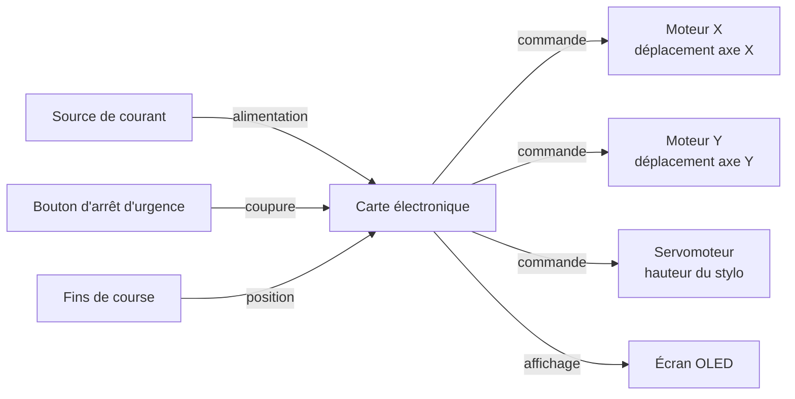

# Conception

{: .a_supprimer }
> **Une page par sous-système, pas une seule page pour toute la conception.**
> Ce template propose un découpage par domaine (mécanique, électronique,
> firmware, software) avec un exemple de sous-système dans les deux premiers. Adaptez-le à votre projet :
> - dupliquez une page d'exemple pour chaque sous-système (pince, châssis, carte capteurs…) ;
> - renommez ou supprimez les domaines qui ne vous concernent pas ;
> - si votre projet s'y prête mieux, découpez d'abord par sous-système, puis par domaine.
>
> Une sous-page se déclare avec `parent:` (et `grand_parent:` au niveau en dessous)
> dans son en-tête : inspirez-vous des pages d'exemple.

## Architecture du système

Notre machine est découpée en sous-systèmes qui communiquent autour d'une carte électronique centrale. Le schéma ci-dessous montre qui commande quoi et ce qui alimente quoi : les entrées (alimentation, arrêt d'urgence, fins de course) sont à gauche, la carte au centre, et les éléments qu'elle commande à droite.

### Fonctionnement général

La **source de courant** alimente la carte électronique, qui est le cerveau de la machine. La carte reçoit les instructions de tracé (le G-code) et les transforme en mouvements : le **moteur X** et le **moteur Y** déplacent le stylo sur la feuille, et le **servomoteur** le lève ou le baisse (axe Z) pour tracer ou se déplacer sans dessiner. Le tracé complet résulte de la combinaison de ces trois mouvements.

### Sécurité

Le **bouton d'arrêt d'urgence** est relié directement à la carte et permet de couper la machine à tout moment. Les **fins de course** signalent à la carte qu'un axe est arrivé au bout de sa course : elles servent à définir le point de départ du dessin et à éviter que la machine force contre une butée.

### Description des blocs

| Bloc | Rôle |
|---|---|
| Source de courant | Alimente la carte électronique. |
| Bouton d'arrêt d'urgence | Coupe la machine immédiatement en cas de problème. |
| Fins de course | Indiquent à la carte quand un axe arrive au bout de sa course (mise à zéro et protection). |
| Carte électronique | Cerveau de la machine : elle reçoit le G-code et pilote les moteurs. |
| Moteur X | Déplace le stylo le long de l'axe X. |
| Moteur Y | Déplace le stylo le long de l'axe Y. |
| Servomoteur | Lève ou baisse le stylo (axe Z) pour tracer ou se déplacer sans dessiner. |
| Écran OLED | Affiche l'état de la machine à l'utilisateur. |