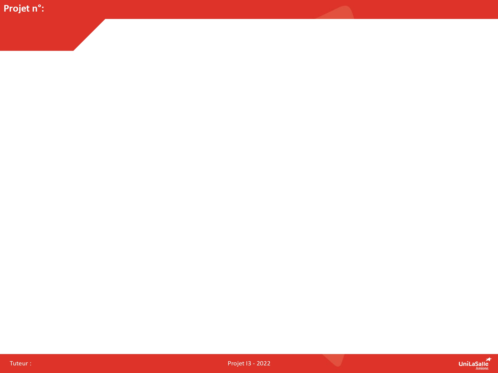

{: .a_supprimer }
> Ce site est le **template de documentation** de votre projet. Tout ce qui est
> marqué « À modifier » est un exemple à remplacer par votre contenu, tout ce qui
> est marqué « À supprimer » est une consigne à retirer avant le rendu final.
>
> Le découpage des pages est un **point de départ** : ajoutez, renommez, divisez
> les pages selon les besoins de votre projet.
>
> Les guides pour prendre en main ce template sont sur le
> [site de documentation du MakerSpace](https://doc.makerspace-amiens.fr/workshops/methodologie-de-projet/).

# Traceur cartésien : la machine à dessiner du Groupe 03

Notre projet est une **machine à dessiner automatique** de type cartésien : elle trace sur une feuille de papier une image vectorielle avec un vrai stylo, à partir d'un fichier de G-code. Elle est destinée aux étudiants et aux makers du MakerSpace qui veulent obtenir un dessin « fait main » (hachures, couleurs, textes) sans savoir bien dessiner, ainsi qu'aux enseignants pour une démonstration de mécanique, d'électronique et de programmation.

Elle répond à un problème simple : les traceurs du commerce sont chers et fermés, alors que notre machine est abordable, modifiable et équipée d'un arrêt d'urgence, de fins de course et d'un écran de contrôle.

[Notre repo GitHub]({{ site.gh_edit_repository }}){: .btn .btn-primary .fs-5 .mb-4 .mb-md-0 .mr-2 }
[Notre projet sur Onshape](https://cad.onshape.com/documents/6fd3f4ae637bb1ff153c05d5/w/0a9df4f99a9ff77a84ce92ff/e/29787623243c0eac65221992){: .btn .fs-5 .mb-4 .mb-md-0 }

## Le projet en 3D



{: .a_modifier }
> Exportez votre assemblage au format **GLB** (glTF binaire) depuis Onshape
> (clic droit sur l'onglet de l'assemblage > Exporter), placez-le dans `docs/assets/models/`,
> remplacez `Otto.glb` ci-dessus par le nom de votre fichier, puis supprimez `Otto.glb`.
> Gardez le fichier sous **25 Mo**.

## Poster

{: .a_modifier }
> Remplacez `docs/assets/images/poster.jpg` par votre poster (image de moins de **2 Mo**).

## Vidéo

<video src="assets/images/intro_amiens.mp4" controls title="Présentation du projet" style="width: 100%;"></video>

{: .a_modifier }
> Remplacez `docs/assets/images/intro_amiens.mp4` par votre vidéo :
> - 1 min 30 au format vertical ;
> - présentation du projet, fonctionnement, vues du prototype, conclusion ;
> - moins de **25 Mo** (exportez en 720p, par exemple avec HandBrake).
>
> Voir [Créer le poster et la vidéo de présentation](https://doc.makerspace-amiens.fr/workshops/methodologie-de-projet/tutorials/poster-video-presentation/).
