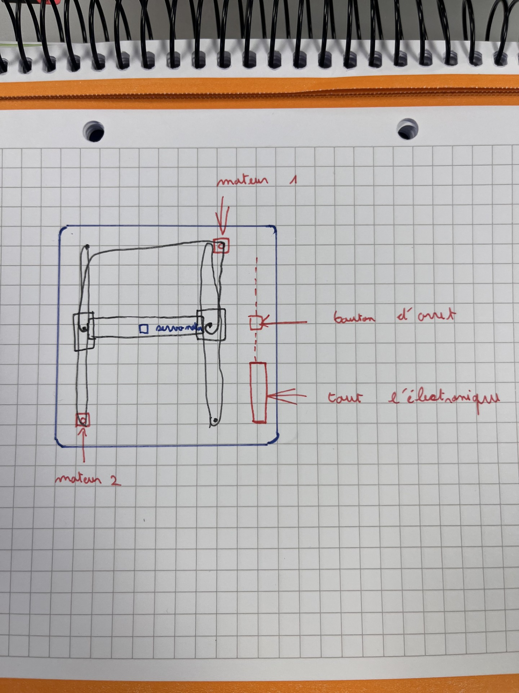
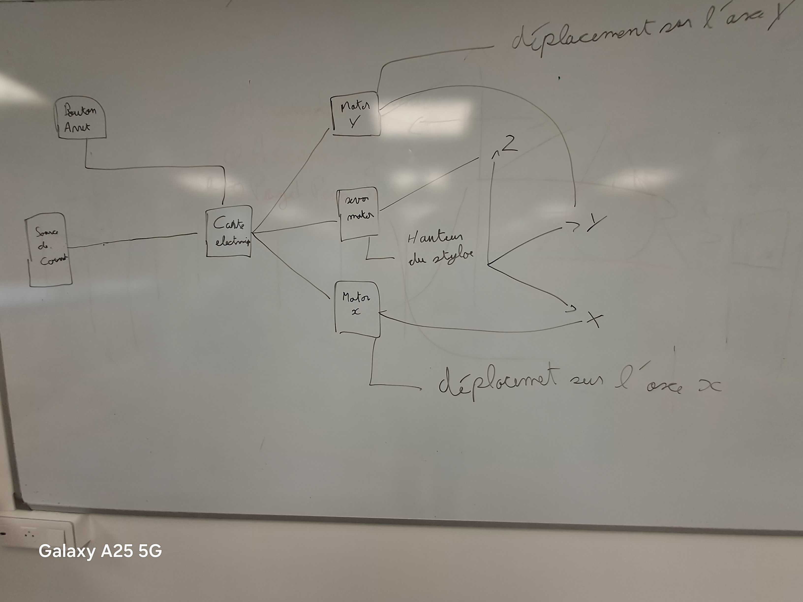

# 2026-10-23 : Premiers croquis et début de modélisation (séance 5)

**Séance :** réalisée · **Durée :** 3 h (9h–12h)

## Fait

- Réalisation des premiers croquis de principe de la machine cartésienne en s'inspirant de conceptions de plotters DIY existants.
- Définition et attribution précise des rôles au sein de l'équipe pour structurer la phase de conception.
- Prise en main d'Onshape et démarrage du modèle 3D préliminaire (gestion des axes et du support de stylo).

## Pourquoi

Poser les premières bases visuelles, s'appuyer sur des retours d'expérience de blogs techniques et répartir clairement le travail de conception pour accélérer le développement de la machine.

## Reste à faire

- Poursuivre et finaliser la conception CAO globale de la machine cartésienne sur Onshape.
- Détailler la modélisation et l'intégration mécanique de chaque sous-ensemble (axes X, Y et Z).

## Sources et inspirations

- [Créer une Machine à Dessiner DIY Plotter pour l'Art Génératif - Jawhar Kodadi](https://jawharkodadi.com/creer-une-machine-a-dessiner-diy-plotter-mon-aventure-dartiste-technophile/) – Récit d'ingénierie et choix de modélisation 3D pour un traceur à stylo.
- [Une machine à faire des dessins - Toysfab](https://toysfab.com/2018/06/une-machine-a-faire-des-dessins/) – Expérimentations autour de la mécanisation des axes et du mouvement de dessin.
- [Réalisez vous-même un Drawbot Scriboo - Reprap-France](https://www.reprap-france.com/article/realisez-vous-meme-un-drawbot-scriboo) – Documentation sur les structures de machines à dessiner de type cartésien/coordonnées.