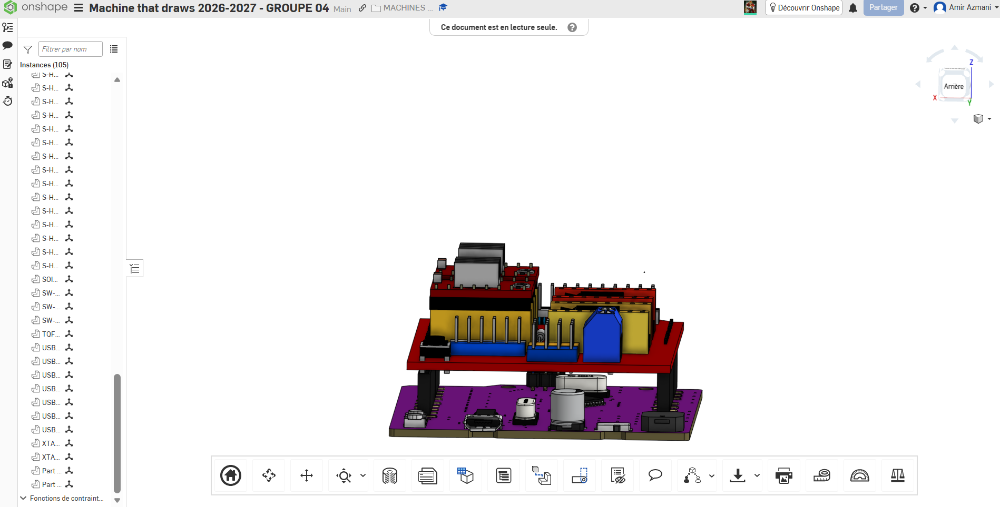
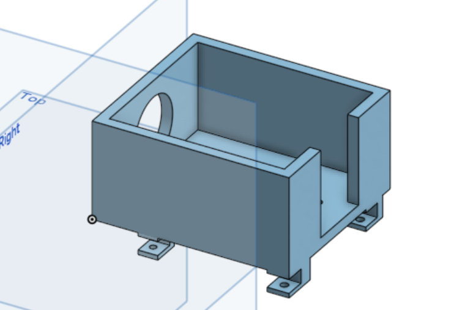

# 2026-11-20 : Conception Onshape et formation de groupes (séance 7)

**Séance :** réalisée · **Durée :** 3 h (9h–12h)

## Fait

- Poursuite de la conception de la machine sur Onshape.
- Formation de groupes de travail pour répartir les tâches :
  - Moi et Amir : travail sur Onshape, modelisation de la boite de la carte.
  - Maxime et Victor : rédaction du cahier des charges.
  - Mattheo : première modélisation de la machine, afin d'identifier les pièces qui nécessitent une modification 3D.
- Assemblage de deux pièces : la carte rouge (avec ses drivers) montée sur la carte violette qui va servir à bien se projetezr sur la modélisation.
!
-Conception d'une pièce servant à protéger les cartes et a les positionner a un point fixe.
## Pourquoi

Répartir le travail pour avancer en parallèle sur la modélisation et le cahier des charges, et repérer dès maintenant les pièces à modifier en 3D et avancer.

## Reste à faire

- Récupérer la première modélisation de Mattheo et lister les pièces à modifier en 3D.
- Finaliser la modélisation 3D globale de la machine sur Onshape.
- Vérifier les assemblages, les tolérances et l'intégration mécanique des sous-ensembles (axes X, Y, Z).

## Sources et inspirations

- Projets et réalisations des années précédentes, utilisés comme source d'inspiration pour la conception de la machine.