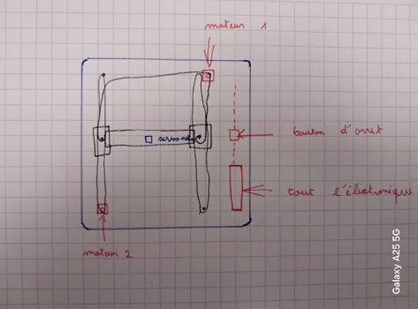

# 2026-10-23 : finition des recherches pieces et de lexistant

**Séance :** planifiée · **Durée :** 3 h

## Fait

Nous avons terminé la recherche de l’existant en étudiant plusieurs projets des années précédentes. Nous avons également analysé les pièces sur Onshape afin de comprendre leur rôle, leurs dimensions et leur assemblage. Enfin, nous avons réalisé un premier schéma rapide de notre machine cartésienne.

## Pourquoi

Cette recherche nous permet de nous appuyer sur des solutions qui fonctionnent déjà et d’éviter les erreurs rencontrées par les groupes précédents. Elle nous aide également à justifier nos choix techniques et à mieux comprendre les différents sous-systèmes de la machine avant sa conception.

## Reste à faire

Lors de la prochaine séance, nous commencerons le développement du code ainsi que la conception et la modification des premières pièces nécessaires à la réalisation du projet.